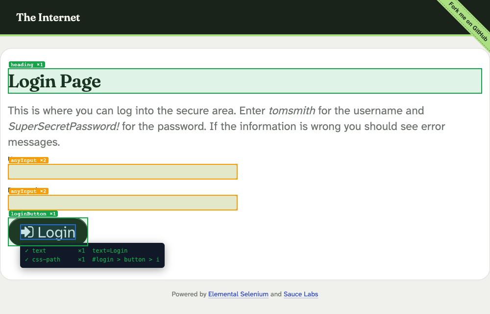
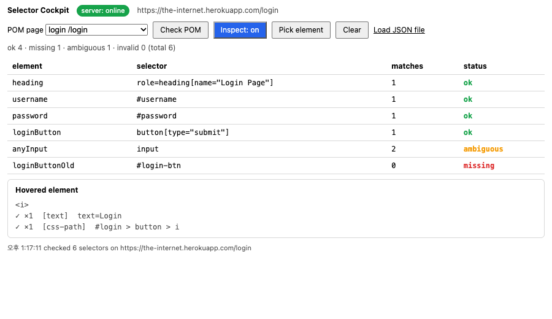

# Selector Cockpit

브라우저 안에서 셀렉터가 **몇 개를 잡는지** 바로 보고, Page Object(POM) JSON과 **실제 페이지를 대조**하는 개발도구.
Chrome DevTools 패널 + 로컬 POM 서버 + MCP 서버(에이전트용) 세 조각으로 되어 있다.

> **English summary** — A Chrome DevTools extension that shows, on hover, selector candidates for any element together with how many elements each one matches in the document (0 = broken, 1 = unique, 2+ = ambiguous). Load a Page Object JSON and it reconciles every selector against the live page in a colour-coded table; click an element to add it to the POM through a local server. An MCP server exposes the same checks to AI agents (`check_selectors` measures real match counts in headless Chromium). Everything binds to `127.0.0.1`, works read-only when the server is down, and verifies extension load through CDP instead of assuming it.

---

## 무슨 문제를 푸나

UI 자동화 테스트는 셀렉터 위에 서 있다. 그런데 셀렉터는 조용히 썩는다.

| 상황 | 테스트에서 벌어지는 일 |
|---|---|
| 셀렉터가 **0개**를 잡는다 (마크업 변경) | "요소 없음"으로 실패 — 그나마 보인다 |
| 셀렉터가 **2개 이상**을 잡는다 | 프레임워크가 첫 번째를 집어 **엉뚱한 요소**를 클릭/검증한다. 테스트는 통과하거나(거짓 통과) 이유 모를 실패(거짓 실패)를 낸다 |

두 번째가 더 위험하다. 실패 로그에 "2개 잡혔다"는 말이 안 나온다. Selector Cockpit은 그 숫자를 **코드를 돌리기 전에, 브라우저에서** 보여준다.

- 요소 위에 마우스를 올리면: `id` · `data-testid` · `name` · `role+name` · `text` · CSS 경로 후보와 각 후보의 **문서 내 매치 수**. 유일하지 않으면 주황, 없으면 빨강.
- POM JSON을 올리면: 페이지의 요소 하나하나에 대해 **0 / 1 / 2+** 를 표로 보여주고, 페이지에 색으로 칠한다.
- 요소를 클릭하면: 이름을 붙여 POM에 넣는다. 서버가 파일에 원자적으로 저장한다.
- 에이전트는 MCP로 같은 걸 한다: `check_selectors(url, selectors)` 가 실제 브라우저에서 매치 수를 잰다.

### [pom-scout](https://github.com/tmkim0512-max/pom-scout) 와 뭐가 다른가

| | pom-scout | **selector-cockpit** |
|---|---|---|
| 역할 | 웹앱을 **탐색해서** 유일성 검증된 셀렉터로 POM JSON을 **생성** | 사람·에이전트가 브라우저에서 **실시간으로 셀렉터를 검사**하고 기존 POM과 **대조** |
| 시점 | POM이 없을 때 (만들기) | POM이 있을 때 (깨졌나 보기, 손보기) |
| 인터페이스 | CLI 배치 | DevTools 패널 + MCP |

---

## 구성도

```
┌────────────────────────── Chrome for Testing ──────────────────────────┐
│  페이지 (content script: core.js + content.js)                          │
│    hover → 후보 + 매치 수 툴팁 / POM 대조 결과를 색으로 칠함              │
│                 ▲ chrome.tabs.sendMessage                               │
│  DevTools 패널 (panel.js)  ──runtime.sendMessage──►  service worker     │
│    POM 표 · Inspect · Pick · Add                        (background.js)│
└──────────────────────────────────────────────────────────────┬─────────┘
                                                      fetch    │ http://127.0.0.1:4777
                                                               ▼
                      ┌───────────────────────────────────────────────┐
                      │ 로컬 POM 서버 (server/server.js, node:http)    │
                      │   GET/PUT/DELETE /pages/:name  · 원자적 쓰기    │
                      │   server/pom/*.json  ◄──────────────┐          │
                      └─────────────────────────────────────┼──────────┘
                                                            │ 같은 파일을 직접 읽고 씀
                      ┌─────────────────────────────────────┴──────────┐
                      │ MCP 서버 (mcp/index.js, stdio)                  │
                      │   list_pages · get_page_objects                 │
                      │   check_selectors (headless Chromium) · add_element │
                      └────────────────────────────────────────────────┘
```

`extension/core.js` 하나가 후보 생성·매치 수 계산·POM 대조 로직 전부다. 콘텐츠 스크립트, 패널, MCP 서버(Playwright 페이지에 주입), 테스트가 같은 파일을 쓴다.

---

## 설치 · 실행

필요: Node 20+ (Playwright 의 최소 버전, 개발은 26에서 함), macOS/Linux.

```bash
git clone <this repo> && cd selector-cockpit
npm install
npx playwright install chromium     # Chrome for Testing 다운로드

npm run cockpit                     # 한 줄로 전부 기동
```

`npm run cockpit` 이 하는 일:

1. Playwright 번들 Chromium(Chrome for Testing)을 원격 디버깅 포트(`--port`, 기본 9333)와 확장 로드 옵션으로 띄운다.
2. **CDP `/json/list` 에 확장의 `service_worker` 타겟이 보이는지 확인**한다. 안 보이면 이유를 찍고 exit 1.
   (최근 일반 Chrome은 `--load-extension` 을 조용히 무시한다 — 그래서 일반 Chrome을 안 쓰고, 로드됐다고 가정하지도 않는다.)
3. 로컬 POM 서버를 `127.0.0.1:4777` 에 띄운다. 포트가 막혀 있으면 브라우저를 닫고 exit 1.
4. 데모 사이트 <https://the-internet.herokuapp.com/login> 을 연다.

브라우저에서 **F12 → "Selector Cockpit" 탭**. 예시 POM `login` 이 URL로 자동 선택되고 대조 표가 뜬다.

옵션: `--url <주소>` `--port <CDP포트>` `--pom-dir <경로>` `--profile <프로필경로>` `--headless`

서버만: `npm run server` (`POM_PORT`, `POM_DIR` 환경변수). MCP만: `npm run mcp`.

### 서버가 꺼져 있으면

패널은 **읽기 전용**으로 계속 동작한다. 배지가 `server: offline (read-only)` 로 바뀌고 "Add to POM" 이 비활성화되지만, Inspect(hover)·Pick·"Load JSON file" 로 올린 POM 대조는 전부 된다.

---

## 스크린샷

예시 POM 에는 일부러 깨진 셀렉터(`loginButtonOld` → `#login-btn`, 0개)와 모호한 셀렉터(`anyInput` → `input`, 2개)가 들어 있다.

**페이지** — POM 대조 결과(초록 1 / 주황 2+)와 hover 툴팁(후보별 매치 수):



**DevTools 패널** — 상태표 + 방금 hover한 요소의 후보:



(`npm run screenshots -- --demo` 로 재생성. 네트워크 없이 로컬 픽스처로 찍는 `npm run screenshots` 도 있다.)

---

## POM JSON 형식

`server/pom/<page>.json` 하나가 페이지 하나.

```json
{
  "name": "login",
  "url": "https://the-internet.herokuapp.com/login",
  "urlPattern": "/login",
  "elements": {
    "username": "#username",
    "loginButton": "button[type=\"submit\"]",
    "heading": "role=heading[name=\"Login Page\"]",
    "anyInput": { "selector": "input", "note": "intentionally ambiguous" }
  }
}
```

- `urlPattern`: 부분 문자열 또는 `/정규식/`. 패널이 현재 URL로 페이지를 자동 선택할 때 쓴다.
- 셀렉터 문법: CSS(기본) · `text=정확한 텍스트` · `role=button[name="Log in"]`. 뒤 둘은 Playwright 문법의 **축소판**이다(아래 한계).

---

## MCP 도구

`mcp/index.js` 를 stdio MCP 서버로 등록한다. 예 (Claude Code `.mcp.json`):

```json
{ "mcpServers": { "selector-cockpit": { "command": "node", "args": ["/abs/path/selector-cockpit/mcp/index.js"], "env": { "POM_DIR": "/abs/path/selector-cockpit/server/pom" } } } }
```

| 도구 | 인자 | 하는 일 |
|---|---|---|
| `list_pages` | — | 페이지 이름·URL 패턴·요소 수 |
| `get_page_objects` | `page` | 한 페이지의 요소명 → 셀렉터 |
| `check_selectors` | `url`, `selectors[]` 또는 `page`, `timeoutMs?` | headless Chromium 으로 `url` 을 열고 셀렉터별 **실제 매치 수**(0/1/2+)와 요약을 반환 |
| `add_element` | `page`, `name`, `selector`, `note?` | 요소 추가/덮어쓰기 (원자적 파일 쓰기) |

MCP 서버는 POM 파일을 직접 읽고 쓰므로 HTTP 서버 없이도 동작한다. 네비게이션 실패·잘못된 페이지명은 `isError` 로 돌아온다(빈 결과로 위장하지 않음).

---

## 테스트

```bash
npm test              # unit (11 core + 7 server + 5 launcher) + e2e (6, 실제 확장 로드) + mcp (8)   — 네트워크 불필요
npm run test:demo     # 데모 사이트 대상 1건 — 네트워크 필요
npm run red-check     # 유일성 규칙을 일부러 깨고 unit 테스트가 RED 가 되는지 확인
```

- **unit** — `core.js` 를 `page.setContent()` 로 띄운 고정 HTML에서 검증 (후보 생성·매치 수·text/role 문법·POM 대조·URL 매칭). 서버는 HTTP 로 직접 쳐서 Origin/Host/경로 탈출/원자적 쓰기를 검증.
- **e2e** — Playwright 로 **확장이 실제로 로드된 Chromium** 을 띄운다. 확장 로드는 CDP `/json/list` 에 **이 확장의 ID**(manifest `key` 로 고정)를 가진 `service_worker` 타겟이 있는지로 확인. 콘텐츠 스크립트의 POM 대조 결과·오버레이가 매치 수를 안 바꾸는지·hover 툴팁·패널 표·Pick→Add→파일 저장·패널이 열린 채 서버가 죽었을 때의 읽기 전용 전환까지 본다. (DevTools 창 자체는 Playwright 가 못 붙으므로 패널은 `panel.html?tabId=` 로 탭에 열어 검증한다 — 따라서 `devtools.js` 의 패널 **등록** 자체는 자동 테스트 밖이다.)
- **mcp** — 공식 SDK 클라이언트로 stdio 서버를 띄워 도구 4개를 호출.
- **red-check** — 먼저 원본으로 baseline 이 green 인지 확인한 뒤, `count === 1 → ok` 를 `count >= 1 → ok` 로 바꾼 사본으로 다시 돌려 **유일성 테스트 4개가 이름까지 맞게** RED 가 되는지 본다. 그대로 green 이면 exit 1, baseline 이 깨져 있으면 exit 2.

e2e 는 확장이 고정으로 바라보는 `127.0.0.1:4777` 을 쓴다. 그 포트가 사용 중이면 이유를 찍고 실패한다.

---

## 보안 · 권한

- 서버는 `127.0.0.1` 에만 바인딩. CORS 헤더를 내지 않고, `chrome-extension://` 이 아닌 `Origin` 은 403, loopback 이 아닌 `Host` 도 403(DNS rebinding 방어). 셋 다 `tests/unit/server.test.mjs` 로 고정돼 있다.
- 확장 권한: `host_permissions` 는 `http://127.0.0.1:4777/*` 하나. `tabs`·`scripting`·`storage` 없음. 콘텐츠 스크립트는 `http(s)://*/*` 에 올라가지만 패널이 켜기 전에는 아무것도 그리지 않는다.
- 페이지 이름은 `[A-Za-z0-9._-]` 로 제한 (경로 탈출 방지). 요청 본문 1MB 제한.

---

## 한계

- **Shadow DOM 을 뚫지 않는다.** `document.querySelectorAll` 기준이라 shadow root 안의 요소는 0 으로 나온다.
- **iframe 안은 보지 않는다.** 콘텐츠 스크립트는 최상위 프레임에서만 센다.
- `text=` / `role=` 은 Playwright 의 **축소판**이다: `text=` 는 공백 정규화 후 **정확 일치**(부분 일치·정규식 없음), `role=` 은 흔한 태그의 암시적 role 과 `aria-label` / `<label for>` / 텍스트 기반 접근성 이름만 안다. `aria-hidden`, `display:none` 요소도 센다 — Playwright 는 안 센다.
- CSS 는 브라우저 문법 그대로이므로 Playwright 전용 `:has-text()`, `>>` 는 invalid 로 표시된다.
- 매치 수는 **지금 이 순간의 DOM** 이다. 동적으로 나타나는 요소는 나타난 뒤 "Check POM" 을 다시 눌러야 한다.
- 일반 Chrome(stable)에서는 `--load-extension` 이 무시될 수 있어 `cockpit` 은 Chrome for Testing 만 쓴다. 일반 Chrome 에 쓰려면 `chrome://extensions` 에서 "압축해제된 확장 프로그램" 으로 `extension/` 을 직접 로드하면 된다 (이 경로는 자동 검증하지 않는다).
- 서버와 MCP 가 같은 파일을 각자 원자적으로 쓰지만(임시 파일은 랜덤 이름으로 배타 생성), 동시에 같은 페이지를 쓰면 나중 쓰기가 이긴다.
- DevTools 패널 **등록**(`devtools.js`)과 실제 DevTools 창 안의 렌더링은 Playwright 가 붙을 수 없어 자동 테스트에서 빠져 있다. 패널 로직은 같은 HTML 을 탭으로 열어 검증한다.
- POM 하이라이트는 스크롤·리사이즈에 따라오지만, 페이지가 DOM 을 바꾸면 "Check POM" 을 다시 눌러야 한다.

---

## 파일 구조

```
extension/   manifest.json · core.js(공유 로직) · content.js · background.js · devtools.* · panel.*
server/      server.js(HTTP, 127.0.0.1:4777) · store.js(원자적 JSON 저장) · pom/*.json(예시 POM)
mcp/         index.js(stdio MCP, 도구 4개)
scripts/     cockpit.mjs(런처) · red-check.mjs · screenshots.mjs · lib/browser.mjs(CDP 로드 확인)
tests/       unit/ · e2e/ · mcp/ · fixtures/page.html · helpers.mjs
docs/        스크린샷
```

## License

MIT © Kim Taemin
